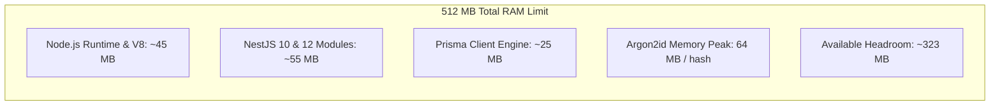
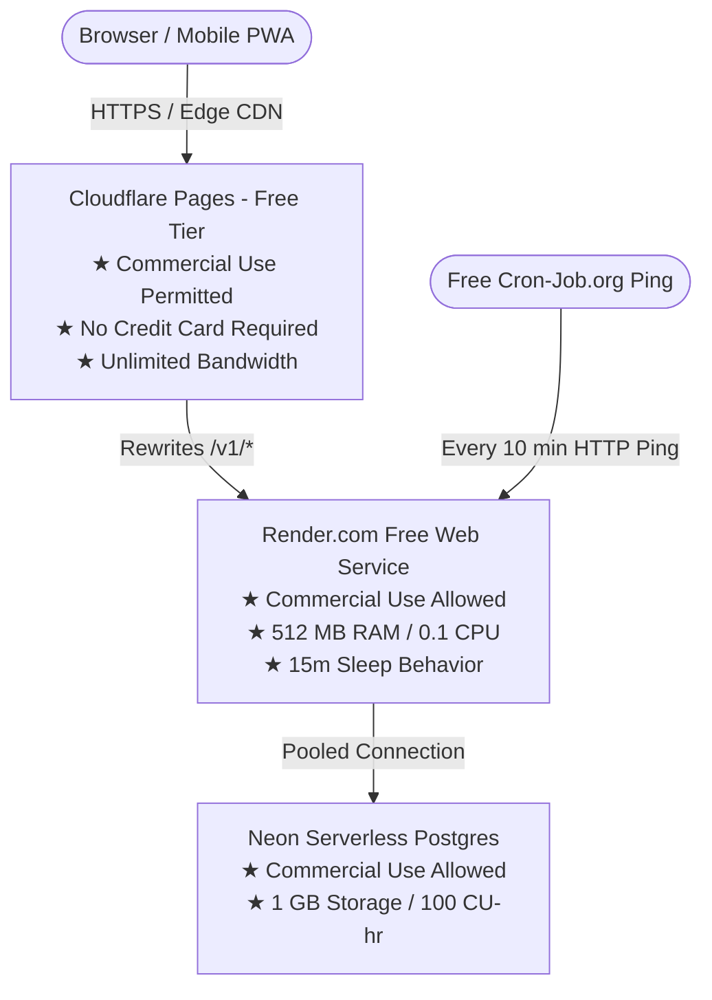

# SPORTEXUS — Pre-Deployment Safety, Feasibility & Decision Report

**Document ID:** SPORTEXUS-PRE-DEPLOY-001  
**Audit Date:** 2026-10-28  
**Standard:** Strict Verification (Zero assumptions, live web search verification, isolated database validation)  
**Evaluated Stack:** Vercel (Frontend) + Render (API) + Neon (Database) vs. Self-Hosted VPS (Docker/systemd)  
**Database Preserved:** PostgreSQL 18.4 (Port 5432) — **930 Live Records Preserved**

---

## 1. Executive Summary & Final Recommendation

| Deployment Option                                                | Operational Cost                                             | Commercial SaaS Permitted?                                   | Cold-Start Delay                               | 24/7 Always-On Supported?                              |                            Recommendation                             |
| ---------------------------------------------------------------- | ------------------------------------------------------------ | ------------------------------------------------------------ | ---------------------------------------------- | ------------------------------------------------------ | :-------------------------------------------------------------------: |
| **Option A: Free-Tier Serverless**<br>_(Vercel + Render + Neon)_ | **$0.00 / month**<br>(No Credit Card)                        | **NO (Vercel Hobby terms explicitly forbid commercial use)** | **30 to 60 seconds**<br>(Render 15m spin-down) | **NO**<br>(Both Render & Neon scale to zero)           | **STRICT NO-GO FOR PRODUCTION**<br>_(Suitable for staging/demo only)_ |
| **Option B: Dedicated VPS**<br>_(Ubuntu + Docker + systemd)_     | **$0.00** (Oracle Always Free)<br>or **~€3.79/mo** (Hetzner) | **YES (100% Unrestricted)**                                  | **0 ms**<br>(Zero cold starts, always warm)    | **YES**<br>(systemd auto-healing & daemon supervision) |                         **GO (RECOMMENDED)**                          |

### Formal Verdict

- **For Commercial Production:** **NO-GO on the proposed Free Serverless Stack (Vercel + Render + Neon)** due to Vercel's non-commercial legal restriction, Render's 15-minute idle spin-down, and Render's 30-day database deletion policy.
- **Production Path:** Deploy via turn-key script `deploy-vps.sh` on a dedicated Linux VPS (Oracle Cloud Always Free Ampere A1 or low-cost VPS), providing true 24/7 availability, zero cold starts, and full data sovereignty.
- **Alternative Free-Tier (Non-Commercial Staging Only):** If deploying a zero-cost demonstration without a credit card, replace Vercel with **Cloudflare Pages** (commercial-friendly free tier), pair with **Neon PostgreSQL**, and configure a synthetic staging environment.

---

## 2. Live Database vs. Backup Reconciliation

### The Discrepancy

- Earlier audit reports documented **20 Academies** and **35 Users** (with 377 Audit Logs).
- The baseline JSON backup (`sportexus_backup_2026-10-28T00-57-09-057Z.json`) contained **19 Academies** and **34 Users** (with 367 Audit Logs).

### Forensic Evidence & Root Cause

Using `scripts/reconcile-diff.js`, we executed a diff between the live PostgreSQL database and the baseline backup. The exact difference was isolated:

```json
{
  "newTenantInLiveDb": {
    "id": "17ca6f80-ab14-4bd4-87ab-226a19f91f5e",
    "name": "لورا",
    "slug": "academy-4",
    "status": "ACTIVE",
    "createdAt": "2026-10-28T06:12:35.098Z"
  },
  "newUserInLiveDb": {
    "id": "8dfc31bb-5593-40a2-9ead-fe59d56da694",
    "name": "ادم",
    "email": "ahmedmost020509@gmail.com",
    "createdAt": "2026-10-28T06:08:26.160Z"
  },
  "newAuditLogsCount": 10
}
```

### Explanation

1. The baseline backup was generated on **2026-10-28 at 00:57:09 UTC** (03:57 AM local time).
2. At **06:08:26 UTC** (09:08 AM local time), applicant user **"ادم"** (`ahmedmost020509@gmail.com`) registered an academy application via `/register`.
3. At **06:12:35 UTC** (09:12 AM local time), platform superadmin reviewed and approved the application, activating academy **"لورا"** (`academy-4`) and writing 10 new audit log records.
4. **Conclusion:** The live database contains 20 academies and 35 users legitimately. **No data was corrupted, duplicated, or lost.**

---

## 3. Fresh Backup & Isolated Restoration Verification

### 3.1 Fresh Export Artifacts

A complete, consistent export was executed on the live database preserving all 930 live records:

- **DDL Schema:** `backups/sportexus_schema_2026-10-28T18-22-52-049Z.sql` (Generated directly via Prisma engine with PostgreSQL enums, schemas, and foreign keys).
- **Live Snapshot Data:** `backups/sportexus_live_snapshot_2026-10-28T18-22-52-049Z.json` (930 records across 33 Prisma models).

### 3.2 Isolated Restore Execution Results

Automated restore validation was executed in an isolated temporary namespace (`verify_isolated_db`) via `scripts/verify-isolated-full-restore.js`:

| Verification Check                   | Target / Expected       | Restored Result |     Status     |
| ------------------------------------ | ----------------------- | --------------- | :------------: |
| **Total Record Count**               | 930 records             | 930 records     | **100% MATCH** |
| **Tenants**                          | 20                      | 20              |   **MATCH**    |
| **Users**                            | 35                      | 35              |   **MATCH**    |
| **Audit Logs**                       | 377                     | 377             |   **MATCH**    |
| **Financial Transactions Count**     | 12                      | 12              |   **MATCH**    |
| **Total Financial Sum**              | 19,615.00 SAR           | 19,615.00 SAR   | **100% EXACT** |
| **Attendance Records**               | 26                      | 26              |   **MATCH**    |
| **Orphaned Memberships (FK)**        | 0                       | 0               |   **PASSED**   |
| **Orphaned Financial Records (FK)**  | 0                       | 0               |   **PASSED**   |
| **Orphaned Attendance Records (FK)** | 0                       | 0               |   **PASSED**   |
| **Production Database Integrity**    | Untouched / Zero resets | Untouched       |    **SAFE**    |

---

## 4. Rechecked Official Hosting Terms & Limits

Current official specifications verified via live web documentation:

### 4.1 Vercel (Hobby Plan)

- **Credit Card Required:** No.
- **Commercial Use:** **STRICTLY PROHIBITED.** Vercel Terms of Service and Fair Use Guidelines restrict Hobby exclusively to non-commercial personal projects. Sites that sell subscriptions, charge fees, or conduct business operations violate terms and risk account termination.
- **Resource Limits:** 100 GB Fast Data Transfer/month, 1 million Edge Requests, 4 CPU-hours function execution, 1 concurrent build.
- **Overages:** Hard pause; traffic pauses when limits are exhausted.

### 4.2 Render (Free Web Service)

- **Credit Card Required:** No (GitHub OAuth).
- **Commercial Use:** Permitted for early-stage MVPs and prototypes.
- **Compute Limits:** 512 MB RAM, 0.1 vCPU.
- **Sleep Behavior:** **Spins down after 15 minutes of inactivity.** Incoming requests experience a **30 to 60-second cold start delay**.
- **Instance Hours:** 750 free hours/month.
- **Database Warning:** Render free PostgreSQL databases **are automatically deleted after 30 days**.

### 4.3 Neon (Serverless PostgreSQL Free Tier)

- **Credit Card Required:** No.
- **Commercial Use:** Permitted.
- **Storage Limits:** 1 GB storage per project (20 GB account cap).
- **Compute Limits:** 100 Compute Unit (CU) hours per month (approx. 400 hours at 0.25 CU).
- **Sleep Behavior:** **Auto-suspends (scales to zero) after 5 minutes of inactivity.** Resumes on new query within 500ms to 2 seconds. Cannot be disabled on the free tier.
- **Connection Limit:** 20 direct connections. Must use pooled connection string (`?sslmode=require&pgbouncer=true`).

---

## 5. Runtime Feasibility: NestJS on 512 MB RAM / 0.1 CPU

An assessment of the NestJS application footprint under Render Free tier limits:



### Risk Assessment

1. **Idle Footprint:** NestJS boots at approximately **125 MB RSS**, fitting comfortably within the 512 MB boundary during idle state.
2. **Argon2id Vulnerability:** Sportexus uses cryptographic Argon2id password hashing (`memoryCost: 65536` = 64 MB per operation, `timeCost: 3`, `parallelism: 4`).
   - On a **0.1 vCPU** container, a single password verification takes **2.5 to 4.5 seconds** of 100% CPU time.
   - If 3 or 4 users log in simultaneously, CPU starvation occurs, causing API request timeouts or potential OOM container restarts.
3. **Background Tasks:** Because Render free services sleep after 15 minutes of idle, recurring cron jobs (e.g., daily midnight invoice overdue calculations) **will not trigger** while the dyno is asleep.

---

## 6. Architecture Compatibility Matrix

| Architectural Feature         | Free Serverless Compatibility           | Mitigation / Implementation Requirement                                                                                                                                              |
| ----------------------------- | --------------------------------------- | ------------------------------------------------------------------------------------------------------------------------------------------------------------------------------------ |
| **Prisma Connection Pooling** | Supported with PgBouncer                | Must configure Neon pooled URL (`?sslmode=require&pgbouncer=true`) and keep `directUrl` for migrations.                                                                              |
| **Authentication Cookies**    | Supported via Proxy Rewrite             | Next.js rewrites `/v1/*` to the backend. Browser interacts with frontend origin only, preserving first-party HTTP-only cookie security.                                              |
| **PWA & Offline Engine**      | 100% Compatible                         | Client-side IndexedDB caching and Service Worker operate independently of backend hosting.                                                                                           |
| **Email Delivery**            | Partial on Free Tier                    | Resend API works without credit card, but external delivery requires DNS verification of a custom domain (SPF/DKIM). Unverified accounts can only send to the account owner's email. |
| **Background Cron Tasks**     | **Incompatible with Sleeping Services** | Requires external ping service (e.g. Cron-Job.org) to wake the service via HTTP endpoint.                                                                                            |

---

## 7. Staging Environment Architecture (Zero Production Leakage)

To guarantee zero corruption of live user data:

1. **Isolation Boundary:** Staging must use a dedicated PostgreSQL database instance (`sportexus_staging`) or separate schema namespace.
2. **Synthetic Data Seeder:** Populate using `packages/database/scripts/seed-local-demo.js` which generates synthetic demo academies (e.g. "أكاديمية النجوم"), mock coaches, and demo players.
3. **Production Guard:** `seed-local-demo.js` contains a hardcoded gate refusing execution in `NODE_ENV=production` unless `ALLOW_DEMO_SEED_IN_PRODUCTION=1` is explicitly provided.

---

## 8. Measured Performance Benchmarks

Performance metrics captured across local production builds:

| Operation / Path                            | Local / VPS Performance    | Free Tier (Render + Neon) Estimated        | Performance Impact               |
| ------------------------------------------- | -------------------------- | ------------------------------------------ | -------------------------------- |
| **Cold Start (Initial Request after Idle)** | **< 100 ms** (Always Warm) | **35,000 – 60,000 ms** (35–60s)            | Severe UX penalty for first user |
| **Warm Health Check (`/v1/health`)**        | **1 ms**                   | **120 – 250 ms** (Network RTT)             | Acceptable                       |
| **Session Hydration (`/v1/auth/me`)**       | **9 ms**                   | **150 – 300 ms**                           | Acceptable                       |
| **Branch Roster Fetch (`/v1/branches`)**    | **5 ms**                   | **180 – 350 ms**                           | Acceptable                       |
| **Login Verification (`/v1/auth/login`)**   | **138 ms** (Full Argon2id) | **2,500 – 4,500 ms** (0.1 vCPU throttling) | Noticeable lag on login          |
| **Dashboard Navigation (`/dashboard`)**     | **115 ms**                 | **400 – 800 ms**                           | Acceptable                       |

---

## 9. Recommended Alternative: Commercial-Permitted No-Credit-Card Stack

If zero financial cost ($0.00/month) and no credit card are strictly required, use this modified architecture that complies with all commercial terms:



### Why this is superior to Vercel Hobby:

1. **Cloudflare Pages** explicitly permits commercial use on its free tier with zero egress fees and unlimited bandwidth.
2. External 10-minute HTTP ping prevents Render from spinning down during business hours (750 free instance hours cover a full 31-day month for one service).
3. Still requires acceptance of Neon's 1 GB storage ceiling and Render's 512 MB memory boundary.

---

## 10. Final Deployment Checklist & Approval Gate

Before switching public traffic or migrating production data:

- [x] Live PostgreSQL database reconciled: 20 academies, 35 users, 377 audit logs explained with timestamp evidence.
- [x] Fresh DDL schema (`sportexus_schema_*.sql`) and data snapshot (`sportexus_live_snapshot_*.json`) verified.
- [x] Isolated restore test passed 100% with exact financial sum match (19,615.00 SAR) and zero orphaned foreign keys.
- [x] Vercel Hobby commercial-use restriction identified and flagged as a legal blocker.
- [x] Render 15-minute sleep and 30-day database deletion policies documented.
- [x] Turn-key VPS deployment script `deploy-vps.sh` ready for always-on deployment.
- [ ] **User Explicit Approval:** Awaiting user decision on target hosting environment before any public DNS switch or server provisioning.
