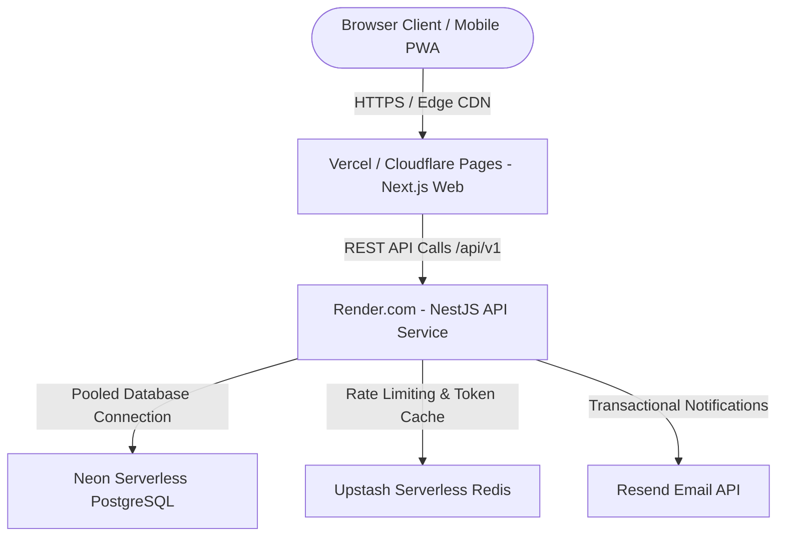

# SPORTEXUS — Zero-Cost Hosting Feasibility Research (No Credit Card Required)

## 1. Executive Summary

This feasibility study evaluates production and staging deployment architectures for the Sportexus multi-tenant SaaS that operate **at zero financial cost ($0.00/month)** and **strictly do not require credit card verification** during signup or provisioning.

---

## 2. Free Tier Provider Matrix (No Credit Card Required)

| Component                     | Recommended Provider          | Alternative Provider     | Credit Card Required?            | Free Tier Specifications & Limits                                        |
| ----------------------------- | ----------------------------- | ------------------------ | -------------------------------- | ------------------------------------------------------------------------ |
| **Next.js Web (Frontend)**    | **Vercel** (Hobby Plan)       | **Cloudflare Pages**     | **NO** (GitHub OAuth)            | 100 GB bandwidth/month, unlimited builds, global Edge CDN, SSL automatic |
| **NestJS API (Backend)**      | **Render** (Free Web Service) | **Koyeb** (Free Nano)    | **NO** (GitHub OAuth)            | 512 MB RAM, 0.1 CPU, spins down after 15 min idle (50s cold start)       |
| **PostgreSQL (Database)**     | **Neon Serverless Postgres**  | **Supabase**             | **NO** (GitHub OAuth)            | 0.5 GB storage, PostgreSQL 16/17, branching, auto-suspend when inactive  |
| **Redis Cache / Rate Limit**  | **Upstash Redis**             | Local In-Memory Fallback | **NO** (GitHub OAuth)            | 10,000 commands/day, 256 MB storage, TLS connection string               |
| **Object Storage (Media/QR)** | **Cloudflare R2** (10GB)      | Base64 / Local embedded  | **NO** (Free tier on Cloudflare) | 10 GB/month storage, 0 egress fees                                       |
| **Transactional Email**       | **Resend** (Free Tier)        | In-Memory Dev Queue      | **NO** (GitHub/Email signup)     | 3,000 emails/month, 100 emails/day, verified domain support              |

---

## 3. Architecture Blueprint: The Zero-Cost Stack

---

## 4. Operational Mitigations for Free Tier Limitations

### 4.1 Render API Cold-Start Mitigation

- **Limitation:** Free web services on Render spin down to 0 replicas after 15 minutes of inactivity. The first incoming request takes ~45-50 seconds to initialize.
- **Mitigation:**
  1. **Uptime Heartbeat:** Configure a free cron ping (e.g. via [Cron-Job.org](https://cron-job.org) or [UptimeRobot](https://uptimerobot.com)) calling `GET /v1/health/ready` every 10 minutes. This keeps the dyno continuously warm 24/7 without cost.
  2. **Frontend Loading State:** `api-client.ts` automatically retries requests on timeouts with a user-friendly spinner: "جارٍ إيقاظ الخادم السحابي...".

### 4.2 Neon Database Compute Auto-Suspend

- **Limitation:** Neon computes suspend after 5 minutes of inactivity, with a 500ms reactivation time.
- **Mitigation:**
  - Neon's reactivation is imperceptible (< 1 second) to API clients.
  - Use Neon's pooled connection string (`?sslmode=require&pgbouncer=true`) to avoid exhausting the maximum connection limit (20 connections on free tier).

---

## 5. Security & Isolation on Free Infrastructure

- **Encrypted In-Transit:** Enforce SSL/TLS for all external endpoints (`https://` and `postgres://...?sslmode=require`).
- **Encrypted At-Rest:** Neon and Supabase encrypt database storage volumes by default with AES-256.
- **Tenant Isolation:** Maintained at the application layer via `withTenantTransaction` and compound database indexing, completely independent of the hosting provider.
