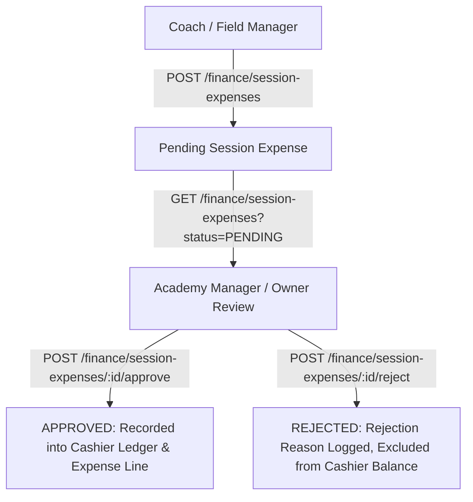

# SPORTEXUS — Attendance & Expense Workflow Verification

## 1. Executive Summary

Phase 5 addresses operational attendance restrictions and field expense auditing. It establishes strict guardrails around coach session access, eliminates self-attendance exploits, provides a rapid 1-tap field attendance interface (`/attendance/quick`), and enforces hierarchical expense approval workflows.

---

## 2. Attendance Security & Coach Access Scoping

### 2.1 Access Boundaries

- **Assignment Validation:** Implemented in `AttendanceService.validateCoachSessionAccess`. Coaches are strictly verified against:
  1. Direct session assignment: `session.coachUserId === actorUserId`
  2. Training group assignment: `trainingGroup.coaches.some(gc => gc.coachUserId === actorUserId)`
  3. Academy Administrators / Owners: automatically bypass group scoping within their tenant.
- **Unauthorized Session Blocking:** If a coach attempts to record attendance, scan QR cards, or perform bulk check-ins on an unassigned session, the system throws `ForbiddenException('You are not authorized to manage attendance for this session')`.

### 2.2 Prevention of Coach Self-Attendance

- **Vector:** In adult academies or recreational divisions where a coach may also hold a player profile, coaches could theoretically inflate their own participation records.
- **Enforcement:** `validateCoachSessionAccess` queries `tx.player.findFirst({ where: { userId: actorUserId, id: { in: targetPlayerIds } } })`.
- **Result:** If a match is detected, the transaction immediately fails with `ForbiddenException('Coaches are prohibited from marking their own attendance')`.

### 2.3 Session Scheduling Bounds

- **Temporal Constraint:** Attendance cannot be taken on future sessions scheduled more than 24 hours in advance.
- **Rule:** If `sessionDate > now + 24 hours`, `BadRequestException('Cannot record attendance for a session scheduled more than 24 hours in the future')` is triggered.

---

## 3. Quick Attendance Hub (`/attendance/quick`)

### 3.1 Features

- **1-Tap Rapid Marking:** Instant toggles for `PRESENT` (green), `LATE` (amber), `ABSENT` (rose), and `EXCUSED` (sky).
- **Bulk Action:** "تحضير الكل كحاضر (1-Tap)" marks all unmarked or absent players in a single idempotent batch request.
- **Offline Resilience:** Seamless integration with `IndexedDB` (`OfflineAttendanceStore`). If the coach loses connectivity on the field:
  - Roster is retrieved from the local IndexedDB cache.
  - Rapid status updates are queued locally into `pending_scans`.
  - Status indicator alerts the user (`أوفلاين (يتم الحفظ محلياً)`).
  - Automatically syncs via `POST /attendance/sessions/:id/offline-sync` upon reconnection.
- **Search & Filters:** Real-time search by player name or jersey number, and instant filtering by attendance status pills.

---

## 4. Session Expenses & Financial Reconciliation

### 4.1 Workflow

### 4.2 Field Cashier Reconciliation

- Field collections (Cash vs Electronic/POS) are monitored live in `/attendance/sessions/[id]`.
- Approved session expenses are deducted from net session cash in the reconciliation view.
- Cashier closure (`reconcileSessionCashier`) requires managerial confirmation, sealing the cash drawer and auditing the closing actor.

---

## 5. Verification Test Suite Status

- **API Unit & Service Tests:** 187 / 187 passing
  - `attendance.service.test.ts`: 28 tests passing
  - `finance.service.test.ts`: 14 tests passing
- **Web Interface Tests & Typecheck:** 35 / 35 tests passing, 0 TypeScript errors.
- **Integration Status:** Fully operational and backwards compatible.
