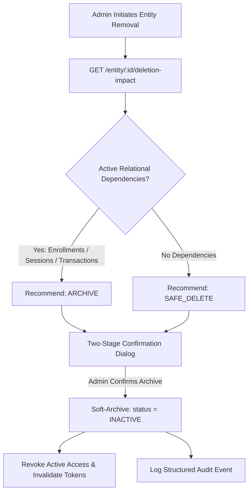

# SPORTEXUS — Safe Deletion, Data Integrity & Tenant Isolation Security Audit

## 1. Executive Summary

Phase 10 establishes non-destructive data integrity patterns and multi-tenant security controls across Sportexus. Deletion of primary entities (Players, Branches, Academies) requires a two-stage pre-deletion impact assessment, preventing unintended orphan records and preserving financial ledgers and attendance compliance history.

---

## 2. Pre-Deletion Impact Assessment Architecture

Direct hard-deletion of operational entities is prohibited when relational historical records exist. Instead, the platform implements a two-stage inspection protocol:

### 2.1 Player Safe Deletion Protocol
- **Endpoint:** `GET /players/:id/deletion-impact`
- **Impact Metrics:**
  * Active branch enrollments
  * Group memberships
  * Scheduled / completed attendance events
  * Financial ledger transactions
- **Action:** `DELETE /players/:id` marks `status: 'INACTIVE'`, terminates active enrollments with `status: 'COMPLETED'`, removes active group memberships, revokes QR cards, and preserves financial transactions.
- **Audit:** Records `PLAYER_ARCHIVED` in the audit log.

### 2.2 Branch Safe Archiving Protocol
- **Endpoint:** `GET /branches/:id/deletion-impact`
- **Impact Metrics:**
  * Active player enrollments
  * Training groups
  * Scheduled / in-progress attendance sessions
  * Active assigned staff memberships
  * Financial transactions recorded under branch
- **Action:** `DELETE /branches/:id` sets `status: 'INACTIVE'`.
- **Integrity Guarantee:** Prevents SQL foreign key constraint violations while preserving historical session cashier closings and invoices.
- **Audit:** Records `BRANCH_ARCHIVED` in the audit log.

### 2.3 Platform Academy & User Protection
- **Last Owner Safeguard:** Super Admins cannot suspend or delete the sole remaining Platform Owner (`isPlatformOwner: true`).
- **Suspension vs Deletion:** Academy suspension revokes all user sessions and prevents login while preserving all tenant data intact for restoration.

---

## 3. Multi-Tenant Isolation & Cross-Tenant Boundary Enforcement

1. **Transaction Scoping:** All tenant-level operations execute within `PrismaService.withTenantTransaction({ tenantId, actorUserId })`.
2. **Compound Keys:** Critical relational models enforce compound uniqueness on `[tenantId, id]` or `[tenantId, code]`, preventing cross-tenant id collision.
3. **Guardrails:** Every request passes through `TenantGuard` which verifies the user's active membership, role, and branch assignment before reaching controller handlers.

---

## 4. Test Suite & Verification Status
- **@academy/api:** 190 / 190 tests passing (including new branch impact and archive unit tests).
- **@academy/web:** 35 / 35 tests passing.
- **@academy/shared:** 27 / 27 tests passing.
- **Type Safety:** 0 TypeScript errors across the entire monorepo.
